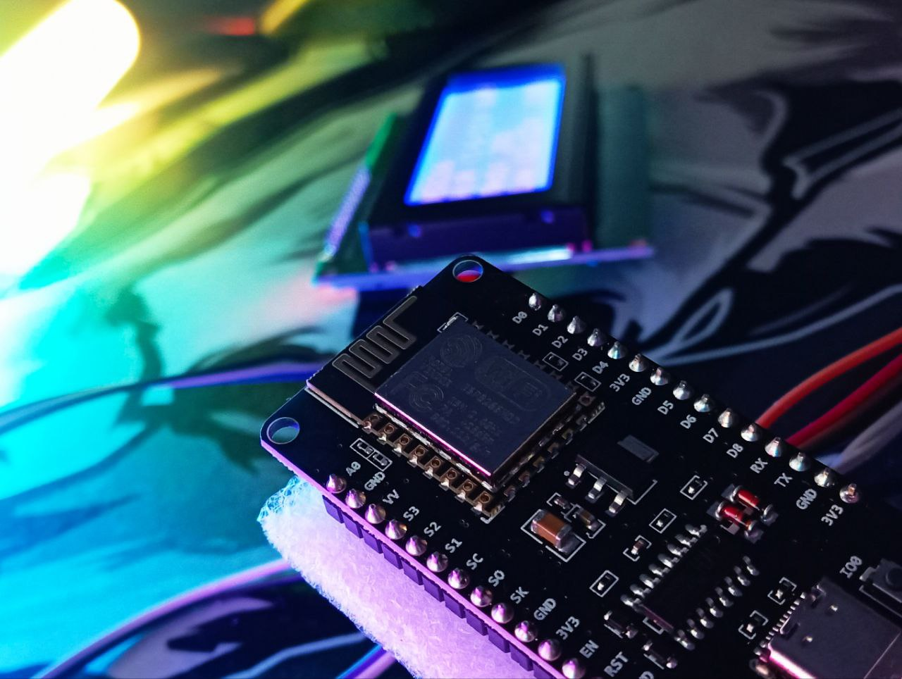
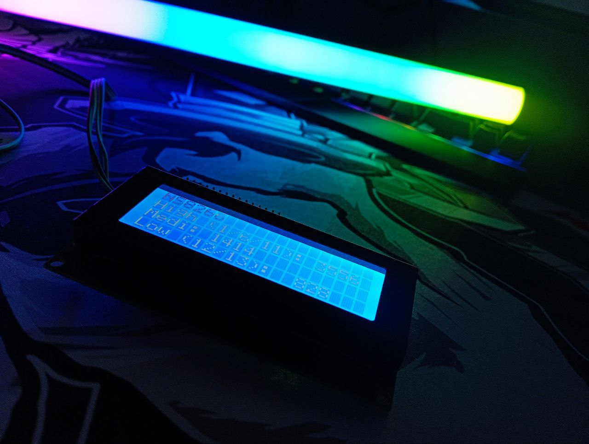
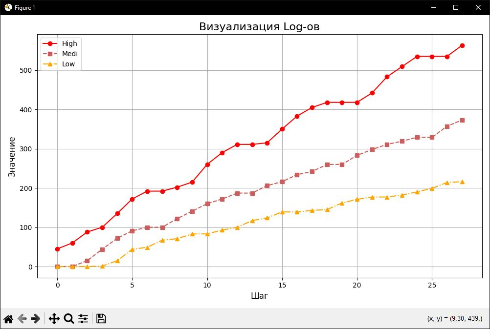

# NS8266 - Wi-Fi Network Scanner & Analyzer 📡


Автономное устройство на базе ESP8266 для мониторинга, анализа и визуализации загруженности Wi-Fi эфира в диапазоне 2.4 ГГц в реальном времени.



## 🎥 Презентация проекта
Хотите увидеть устройство в действии?  
👉 [Интерактивная презентация NS8266](https://view.genially.com/67b60c2da3fee948bc347cbc/presentation-ns8266)

---

## 📊 Описание и принцип работы

**NS8266** переводит Wi-Fi модуль ESP8266 в **Promiscuous Mode** (режим монитора), позволяя захватывать все 802.11 пакеты в радиусе действия, независимо от того, предназначены они этому устройству или нет.

**Алгоритм работы:**
1. **Сниффинг:** Устройство прослушивает эфир, подсчитывая количество пакетов на каждом из 14 каналов.
2. **Динамическая категоризация:** Раз в секунду алгоритм сортирует каналы по уровню активности и динамически распределяет их на 3 группы:
    - 🔴 **High:** 4 самых загруженных канала.
    - 🟠 **Medi:** 4 канала со средней активностью.
    - 🟡 **Low:** Оставшиеся 6 наименее загруженных каналов.
3. **Вывод и логирование:** Агрегированные данные выводятся на I2C LCD-дисплей и сохраняются на SD-карту для последующего глубокого анализа.
4. **Визуализация:** Python-скрипт считывает лог-файл и строит графики трендов загруженности.

---

## ✨ Ключевые особенности

- 📡 **Promiscuous Mode:** Глубокий анализ сетевого трафика на уровне 802.11 фреймов (MAC-адреса, RSSI).
- ⚡ **Неблокирующая архитектура:** Использование аппаратных таймеров (`Ticker`) для смены каналов и обновления UI без блокировки основного цикла `loop()`.
- 📈 **Адаптивный алгоритм:** Динамическая сортировка каналов "на лету" вместо статических预设ок.
- 💾 **Автономность:** Полностью независимое устройство с локальным логированием, не требующее постоянного подключения к ПК.

---

## 🛠️ Аппаратные требования

| Компонент | Описание |
| :--- | :--- |
| **Микроконтроллер** | ESP8266 (NodeMCU v3, Wemos D1 Mini или аналог) |
| **Дисплей** | LCD 2004 (20x4 символа) с I2C-модулем (адрес `0x27`) |
| **Хранилище** | Модуль microSD-карты с логическими преобразователями уровней (3.3V) |
| **Питание** | USB-кабель (5V) или внешний стабилизированный источник |

---

## 🔌 Схема подключения (Pinout)

> ⚠️ **Важно:** Все компоненты питаются непосредственно от ESP8266. Использование дополнительных плат (например, Arduino) для питания не требуется и может вызвать конфликты потенциалов.

| Компонент | Пин ESP8266 | Назначение | Примечание |
| :--- | :---: | :--- | :--- |
| **LCD I2C** | `VIN` (или 5V) | Питание (VCC) | Берет 5V напрямую с USB-входа |
| **LCD I2C** | `GND` | Земля | Общая земля с ESP |
| **LCD I2C** | `D2` (GPIO 4) | SDA | Линия данных I2C |
| **LCD I2C** | `D1` (GPIO 5) | SCL | Линия тактирования I2C |
| **SD-модуль** | `3V3` | Питание (VCC) | Строго 3.3V! |
| **SD-модуль** | `GND` | Земля | Общая земля с ESP |
| **SD-модуль** | `D8` (GPIO 15)| CS (SS) | Chip Select |
| **SD-модуль** | `D5` (GPIO 14)| SCK | SPI Clock |
| **SD-модуль** | `D6` (GPIO 12)| MISO | SPI Master In Slave Out |
| **SD-модуль** | `D7` (GPIO 13)| MOSI | SPI Master Out Slave In |

---

## 💻 Программное обеспечение

### Прошивка ESP8266 (C++)
- **Среда:** Arduino IDE
- **Библиотеки:** `LiquidCrystal_I2C`, `Ticker`, `SD`, `SPI`, `Wire`

### Скрипт визуализации (Python)
- **Версия:** Python 3.8+
- **Зависимости:** `matplotlib`, `tkinter` (обычно встроен в Python)
  ```bash
  pip install matplotlib
  ```

### 🚀 Инструкция по запуску
1. **Сборка:** Соберите схему согласно таблице подключений выше. Вставьте отформатированную (FAT32) microSD-карту в модуль.
2. **Прошивка:**
   * Откройте `NS8266.ino` в Arduino IDE.
   * Выберите плату "NodeMCU 1.0 (ESP-12E Module)" или аналогичную.
   * Загрузите прошивку.
3. **Мониторинг:** После перезагрузки на LCD-экране начнут обновляться счетчики пакетов. Данные автоматически записываются в файл `log.txt` на SD-карте.
4. **Анализ данных:**
   * Извлеките SD-карту и подключите ее к компьютеру.
   * Запустите скрипт визуализации:
   ```bash
   python vizual.py
   ```
   * В открывшемся окне выберите файл `log.txt`. Скрипт построит график динамики загруженности каналов.

### 📋 Пример вывода
**LCD-дисплей:**

```text
NS8266
High: 10075
Medi: 3237
Low (12/13): 2127
```
**График Python:** <br>

🔴 Красная линия: Топ-4 самых шумных канала <br>
🟠 Оранжевая: Каналы со средней активностью <br>
🟡 Желтая: Наименее загруженные каналы

## 📄 Лицензия

Проект распространяется под лицензией MIT. Подробности в файле [LICENSE](LICENSE).

---
_Проект разработан и реализован в рамках углубленного изучения сетевых технологий и Embedded-систем._
